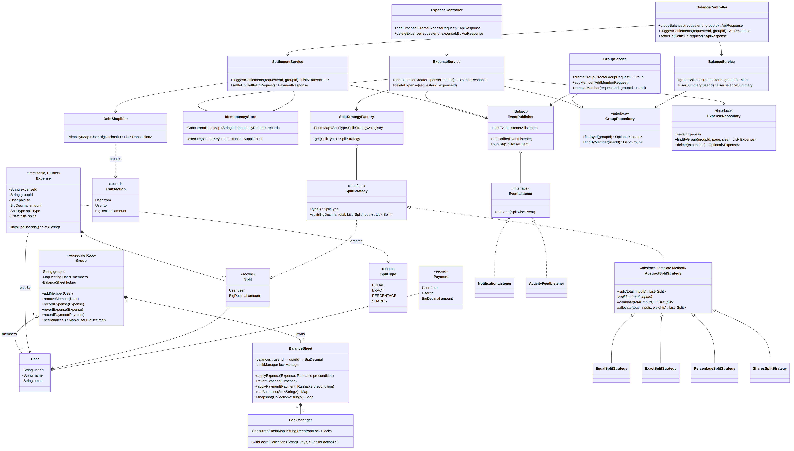
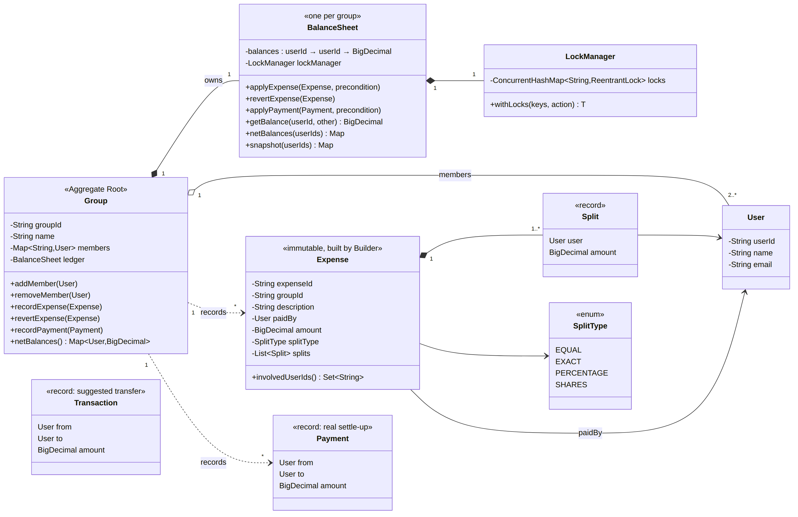
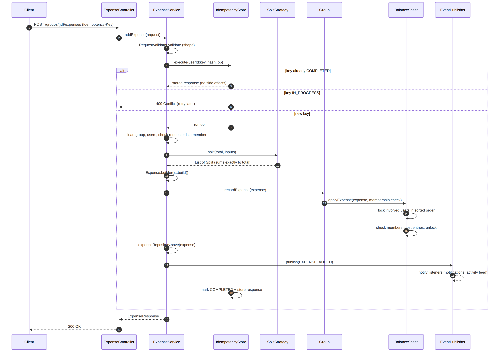
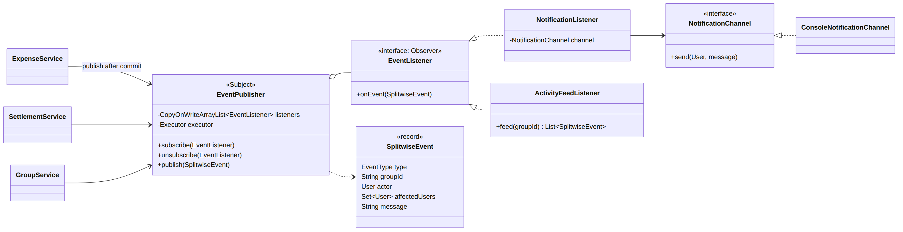

# Splitwise: Low-Level Design Study Notes

*Target: SDE-2 LLD round (Amazon-style). Java 17. Written 24 Sep 2026.*

These notes build on the earlier ChatGPT discussion (core design, debt simplification, concurrency, APIs, idempotency, groups). They fill its gaps, fix a few bugs in the draft code (listed in section 17), and add what it hadn't reached yet: notifications (Observer), settle-up payments, deleting expenses, and tests.

The working code sits next to this file. Run `./run.sh` for the demo and `./run.sh test` for the tests.

---

## Contents

1. [Requirements (say these first)](#1-requirements-say-these-first)
2. [The core idea: expenses become ledger entries](#2-the-core-idea-expenses-become-ledger-entries)
3. [Class diagram](#3-class-diagram)
4. [Layered architecture, APIs and DTOs](#4-layered-architecture-apis-and-dtos)
5. [Design patterns used (and why)](#5-design-patterns-used-and-why)
6. [SOLID, mapped to this design](#6-solid-mapped-to-this-design)
7. [Money: BigDecimal and not losing a paisa](#7-money-bigdecimal-and-not-losing-a-paisa)
8. [Split strategies](#8-split-strategies)
9. [The BalanceSheet (ledger)](#9-the-balancesheet-ledger)
10. [Groups as an aggregate root](#10-groups-as-an-aggregate-root)
11. [Concurrency and thread safety](#11-concurrency-and-thread-safety)
12. [Idempotency](#12-idempotency)
13. [Debt simplification](#13-debt-simplification)
14. [Settle up, delete and edit](#14-settle-up-delete-and-edit)
15. [Notifications with the Observer pattern](#15-notifications-with-the-observer-pattern)
16. [Error handling](#16-error-handling)
17. [What changed from the ChatGPT draft](#17-what-changed-from-the-chatgpt-draft)
18. [Scaling beyond one machine](#18-scaling-beyond-one-machine)
19. [Tests](#19-tests)
20. [Interview playbook](#20-interview-playbook)
21. [One-page cheat sheet](#21-one-page-cheat-sheet)

---

## Project layout

```
Splitwise-LLD/
├── Splitwise-LLD-Study-Notes.md      <- this file
├── run.sh                            <- ./run.sh (demo)   ./run.sh test (tests)
├── docs/                             <- diagrams (.png, .svg, Mermaid .mmd source)
└── src/
    ├── main/java/com/lld/splitwise/
    │   ├── model/          User, Group, Expense, Split, SplitInput, SplitType, Payment, Transaction, Money
    │   ├── strategy/       SplitStrategy, AbstractSplitStrategy, Equal/Exact/Percentage/Shares, SplitStrategyFactory
    │   ├── ledger/         BalanceSheet
    │   ├── concurrency/    LockManager
    │   ├── settlement/     DebtSimplifier
    │   ├── idempotency/    IdempotencyStore, IdempotencyRecord, IdempotencyStatus
    │   ├── observer/       EventPublisher, EventListener, NotificationListener, ActivityFeedListener, ...
    │   ├── repository/     User/Group/Expense/PaymentRepository + inmemory/ implementations
    │   ├── dto/            CreateExpenseRequest, SplitRequest, ExpenseResponse, SettleUpRequest, ...
    │   ├── validation/     RequestValidator
    │   ├── service/        ExpenseService, SettlementService, GroupService, BalanceService, UserService
    │   ├── controller/     ExpenseController, GroupController, BalanceController, ApiResponse
    │   ├── exception/      ValidationException(400), ForbiddenException(403), NotFoundException(404), ConflictException(409)
    │   ├── SplitwiseApplication.java   <- composition root (wires everything)
    │   └── Main.java                   <- end-to-end demo (a Goa trip)
    └── test/java/com/lld/splitwise/SplitwiseTests.java   <- 13 tests, JDK only
```

---

## 1. Requirements (say these first)

Spend the first 3–5 minutes of the interview here. Say what's in scope and what isn't, out loud.

**Functional**

| # | Requirement |
|---|---|
| F1 | Register users |
| F2 | Create groups; add and remove members (a member can leave only when settled) |
| F3 | Add an expense in a group: payer, amount, participants, split type |
| F4 | Split types: **EQUAL, EXACT, PERCENTAGE, SHARES** (new types can be added later) |
| F5 | See balances: per group, between two people, and the user's overall total |
| F6 | **Simplify debts**: suggest the fewest payments that settle a group |
| F7 | **Settle up**: record a real payment |
| F8 | Delete or edit an expense |
| F9 | Notify affected users and keep an activity feed |

**Non-functional**

| Concern | How the design handles it |
|---|---|
| Correctness of money | `BigDecimal`, scale 2; splits always add up exactly |
| Concurrency | Per-user ordered locks; the whole expense is atomic |
| Safe retries | Idempotency keys on every create |
| Extensibility | Strategy + registry: a new split type is a new class |
| Scalability | Stateless services; ledger partitioned by group; paginated reads |

**Out of scope (say so explicitly):** multi-currency, receipts and images, recurring expenses, auth itself (we assume a `requesterId` comes from an auth layer). Section 18 shows how each one would fit.

**Clarifying questions worth asking:** Must every expense be in a group, or are 1-to-1 friend expenses allowed? Should we show simplified debts or raw pairwise debts? Can the payer be left out of the split? Which currency?

---

## 2. The core idea: expenses become ledger entries

> Every expense is turned into **splits**. Each split posts a debt of *participant → payer* into the **group's ledger**. Balances are never stored as "totals typed in by users"; they are always the sum of posted entries.

Worked example (it matches `Main.java`). Rahul pays 1000.00 for dinner, split equally between Rahul, Priya and Amit:

| Split | Amount | Ledger effect |
|---|---|---|
| Rahul | 333.34 | none (your own share creates no debt) |
| Priya | 333.33 | Priya owes Rahul 333.33 |
| Amit | 333.33 | Amit owes Rahul 333.33 |

After four expenses (dinner, cab, villa, drinks), the net positions are:

```
Rahul  -533.34   (owes)
Priya  +266.67   (gets back)
Amit   +566.67
Sara   -300.00
         0.00   <- nets ALWAYS sum to zero (money is only moved, never created)
```

"Nets sum to zero" is the invariant to keep in mind. One of the tests uses it to show that locking works.

---

## 3. Class diagram

### 3.1 Full picture



*Zoomable version: `docs/class-diagram.svg`. Mermaid source: `docs/class-diagram.mmd`.*

Read it from top to bottom: **Controllers → Services → domain (Group, Expense, BalanceSheet) and helpers (strategies, idempotency, events) → Repositories.**

### 3.2 Domain model (the part to draw first on the whiteboard)



The relationships and what they mean:

- **Group ◆— BalanceSheet** (composition): the ledger only exists inside a group, and each group has its own.
- **Group ◇— User** (aggregation): users exist without the group; a group just references them.
- **Expense ◆— Split**: the splits belong to one expense and are immutable.
- **Payment** vs **Transaction**: a `Payment` is real money moved, and it changes the ledger. A `Transaction` is only a *suggestion* from debt simplification. Interviewers like it when you keep the two separate.

### 3.3 The "add expense" flow



---

## 4. Layered architecture, APIs and DTOs

```
Controller  ->  Service  ->  Domain (Group / Expense / BalanceSheet)  ->  Repository
 (HTTP)        (use case)     (rules + invariants)                        (storage)
```

| Layer | Owns | Must NOT do |
|---|---|---|
| Controller | Parse request, call service, map exceptions to HTTP codes | Business logic |
| Service | Orchestrate one use case: load, validate, call domain, save, publish | Rounding, splitting, locking details |
| Domain | Invariants: splits add up, members only, locking | Know about HTTP or the database |
| Repository | Persistence | Business rules |

**APIs**

| Method | Path | Notes |
|---|---|---|
| POST | `/users` | register |
| POST | `/groups` | create with initial members |
| POST | `/groups/{id}/members` | add member |
| DELETE | `/groups/{id}/members/{userId}` | 409 if not settled |
| POST | `/groups/{id}/expenses` | **header `Idempotency-Key`** |
| GET | `/groups/{id}/expenses?page=&size=` | newest first, paginated |
| DELETE | `/expenses/{id}` | reverses the ledger entries |
| GET | `/groups/{id}/balances` | net per member |
| GET | `/groups/{id}/settlements/suggested` | read-only simplification |
| POST | `/groups/{id}/payments` | settle up, **idempotent** |
| GET | `/users/{id}/summary` | overall total + per-group breakdown |

**Why DTOs?** The API contract (`CreateExpenseRequest`) and the domain object (`Expense`) change for different reasons, so either can change without breaking the other. A DTO also never exposes internals such as the ledger.

```java
public record CreateExpenseRequest(String idempotencyKey, String requesterId, String groupId,
        String description, String paidByUserId, BigDecimal amount,
        String splitType, List<SplitRequest> splits) {}

public record SplitRequest(String userId, BigDecimal value) {}  // value meaning depends on split type
```

**Two kinds of validation** (a distinction worth saying out loud):

- **Shape** (`RequestValidator`): nulls, amount > 0, at most 2 decimals, known split type. This fails fast, before any lookups.
- **Business rules** (in the domain and the strategies): percentages add up to 100, participants are members, and so on. They live in the domain so they hold no matter which API called in.

---

## 5. Design patterns used (and why)

| Pattern | Where | Why it is here (the line to say) |
|---|---|---|
| **Strategy** | `SplitStrategy` + 4 implementations | "Each way of splitting is its own class; adding one never touches the others." |
| **Template Method** | `AbstractSplitStrategy.split()` | "Common checks and rounding live in one place; subclasses fill in only `validate` and `compute`." |
| **Factory (registry)** | `SplitStrategyFactory` | "Maps `SplitType` to a strategy with an `EnumMap`, so there is no switch statement to edit." |
| **Builder** | `Expense.builder()` | "Many fields, some optional; `build()` checks that splits add up to the amount." |
| **Observer** | `EventPublisher` → listeners | "Services publish events; notifications and the activity feed subscribe. Adding SMS means no service changes." |
| **Aggregate Root (DDD)** | `Group` | "All changes to a group's ledger go through `Group`, which enforces membership." |
| **Repository** | `*Repository` interfaces | "Services depend on an interface; in-memory now, a database later." |
| **Dependency Injection** | `SplitwiseApplication` | "Instead of a Singleton: no hidden global state, and each test gets a fresh app." |
| **Value Object / immutability** | `Split`, `Payment`, `Transaction` records, immutable `Expense` | "Immutable objects are safe to share between threads." |

### Strategy + Factory, briefly

```java
public interface SplitStrategy {
    SplitType type();
    List<Split> split(BigDecimal total, List<SplitInput> inputs);   // must add up exactly to total
}

public class SplitStrategyFactory {
    private final Map<SplitType, SplitStrategy> registry = new EnumMap<>(SplitType.class);
    public SplitStrategyFactory(List<SplitStrategy> strategies) {
        strategies.forEach(s -> registry.put(s.type(), s));        // a new type = register one more class
    }
    public SplitStrategy get(SplitType type) { ... }
}
```

### Template Method, briefly

```java
public abstract class AbstractSplitStrategy implements SplitStrategy {
    @Override
    public final List<Split> split(BigDecimal total, List<SplitInput> inputs) {   // final: fixed skeleton
        // common checks: total > 0, at least 1 participant, no duplicate users
        validate(total, inputs);          // step supplied by the subclass
        return compute(total, inputs);    // step supplied by the subclass
    }
    protected abstract void validate(BigDecimal total, List<SplitInput> inputs);
    protected abstract List<Split> compute(BigDecimal total, List<SplitInput> inputs);
}
```

### Why not a Singleton `BalanceSheetManager`?

The first draft had one. Three problems:

1. **It isn't thread-safe.** `if (instance == null) instance = new ...` lets two threads create two instances. The usual fixes are an enum singleton, a holder class, or double-checked locking with `volatile`.
2. **It's one global ledger**, which conflicts with ledgers per group.
3. **It's hidden global state**, so tests leak into one another.

The better answer is to build each object once in a **composition root** and pass it into constructors. In Spring, the container does this, and its beans are singletons by *scope*, not by pattern.

---

## 6. SOLID, mapped to this design

| Principle | Where you can point to it |
|---|---|
| **S**ingle responsibility | `ExpenseService` orchestrates; strategies split; `BalanceSheet` keeps the ledger; `IdempotencyStore` handles retries; `DebtSimplifier` runs the algorithm |
| **O**pen/closed | `SharesSplitStrategy` was added without editing any existing class. New listeners (SMS, audit) work the same way |
| **L**iskov substitution | Any `SplitStrategy` can replace another; each keeps the contract that splits add up to the total |
| **I**nterface segregation | Small interfaces: `EventListener.onEvent`, `NotificationChannel.send`, a separate repository for each aggregate |
| **D**ependency inversion | Services depend on `ExpenseRepository` and `EventPublisher` abstractions; the concrete classes are chosen in `SplitwiseApplication` |

---

## 7. Money: BigDecimal and not losing a paisa

- **Never use `double` for money.** `0.1 + 0.2 = 0.30000000000000004`. Use `BigDecimal` with scale 2.
- Compare with `compareTo`, not `equals`. `new BigDecimal("1.0").equals(new BigDecimal("1.00"))` is **false**.
- **Rounding bug in the draft:** `1000 / 3` rounded HALF_UP gives `333.33 × 3 = 999.99`, so one paisa vanishes. The ledger then no longer balances.

**The fix is the largest-remainder idea:** round every share *down*, then hand out the leftover paise one by one.

```java
protected static List<Split> allocate(BigDecimal total, List<SplitInput> inputs, List<BigDecimal> weights) {
    BigDecimal weightSum = sum(weights);
    // 1) every share rounded DOWN to 2 decimals
    shares[i] = total.multiply(w[i]).divide(weightSum, 2, RoundingMode.DOWN);
    // 2) leftover (always < number of people) goes out 0.01 at a time, in input order
    for (int i = 0; remainder > 0; i = (i + 1) % n) { shares[i] += 0.01; remainder -= 0.01; }
}
// 100.00 / 3  ->  33.34, 33.33, 33.33   (sum = 100.00)
```

EQUAL (weights 1,1,1), PERCENTAGE (weights = percentages) and SHARES (weights = shares) all reuse this one helper.

*Follow-up: "who gets the extra paisa?"* Here it's the first participant, which is deterministic. Alternatives are the payer, or rotating the extra paisa between people.

---

## 8. Split strategies

| Type | What `value` holds | Validation | Computation |
|---|---|---|---|
| EQUAL | ignored | ≥ 1 participant | `allocate` with weights 1,…,1 |
| EXACT | rupees | each > 0, at most 2 decimals, **sum == total** | use the values as given |
| PERCENTAGE | percent | each > 0, **sum == 100** | `allocate` with the percents |
| SHARES | weight (2 = couple) | each > 0 | `allocate` with the shares |

A design choice that removes a bug: the draft had `EqualSplit`/`ExactSplit`/`PercentageSplit` subclasses, and the percentage strategy **cast** `(PercentageSplit) split`. Sending the wrong type caused a `ClassCastException`.

This design has one uniform input, `SplitInput(user, value)`, and one output, `Split(user, amount)`. Strategies return **new** `Split`s instead of changing their inputs.

```java
List<Split> splits = strategies.get(type).split(amount, inputs);
```

---

## 9. The BalanceSheet (ledger)

### Representation

```
balances[a][b] > 0   means   b owes a that amount
kept antisymmetric:          balances[b][a] == -balances[a][b]
net(a) = sum of row a        (+ gets back, - owes)
```

```java
private final Map<String, Map<String, BigDecimal>> balances = new ConcurrentHashMap<>();

private void credit(String creditor, String debtor, BigDecimal amount) {  // debtor owes creditor more
    adjust(creditor, debtor, amount);
    adjust(debtor, creditor, amount.negate());
}
private void adjust(String a, String b, BigDecimal delta) {
    balances.computeIfAbsent(a, k -> new ConcurrentHashMap<>())
            .merge(b, delta, (old, d) -> { var s = old.add(d); return s.signum() == 0 ? null : s; }); // zero => entry removed
}
```

- **Expense**: for each split (except the payer's own), `credit(payer, participant, share)`.
- **Payment "A paid B x"**: `credit(A, B, x)`, which reduces what A owes B.
- **Delete**: post the same entries with the amounts negated.

### Pairwise vs net

The pairwise matrix answers "how much do I owe Priya?". The net answers "am I up or down overall in this group?". Settlement uses **net**.

A subtlety found while testing: after simplified settle-ups, a user can be `+x` with one person and `-x` with another. That leftover is circular and nets to zero, so "settled" means **net == 0**, not "every pair is zero".

### Global vs group balances

Balances are stored **only per group**. The user's overall balance is computed on read by adding up their groups (`BalanceService.userSummary`). That leaves one source of truth and no second ledger to keep in sync. At scale, you cache that summary and refresh it from events (a CQRS read model).

Friend (non-group) expenses fit the same code path as an implicit two-person group.

---

## 10. Groups as an aggregate root

```java
public class Group {                                  // Aggregate Root
    private final Map<String, User> members = new ConcurrentHashMap<>();
    private final BalanceSheet ledger = new BalanceSheet();   // one ledger per group

    public void recordExpense(Expense e) {
        ledger.applyExpense(e, () -> requireMembers(e.involvedUserIds()));   // check runs UNDER the locks
    }
    public void removeMember(User u) {
        if (!ledger.runIfSettled(u.getUserId(), () -> members.remove(u.getUserId())))
            throw new ConflictException(u + " has an unsettled balance");
    }
}
```

What to explain:

- **Every write goes through `Group`**, so nobody can post to the ledger for a non-member.
- **Membership is checked while holding the locks.** Otherwise "Sara leaves" could slip in between "check Sara is a member" and "post Sara's debt". That is a *check-then-act* (TOCTOU) race.
- **Expenses are NOT held in a `List` inside `Group`.** They live in `ExpenseRepository`, looked up by `groupId` and paginated, so a group with 50,000 expenses doesn't have to be loaded into memory.
- **Authorization:** only members may read or write a group. `ForbiddenException` maps to 403.
- A per-group ledger is also a natural **partition**: expenses in different groups never contend for a lock.

---

## 11. Concurrency and thread safety

This is the most probed part of the round, so understand it rather than memorize it.

### 11.1 What needs protecting?

The ledger rows of the users an expense touches: the payer and every participant. One expense changes several cells, and it must be **all or nothing** to any reader.

### 11.2 Options and trade-offs

| Approach | Correct? | Concurrency | Comment |
|---|---|---|---|
| `synchronized` on the whole service | yes | none | simplest; blocks every user in every group |
| One lock per group | yes | per group | simple and fine for most groups; a good fallback to mention |
| **Per-user locks, acquired in sorted order** | yes | only the users involved are blocked | **chosen here** |
| `tryLock(timeout)` + back off and retry | yes | high | avoids waiting forever; more code; watch for livelock |
| Optimistic (version per row, compare-and-swap, retry) | yes | high when conflicts are rare | how databases do it; retries under contention |
| Single writer / actor / queue per group | yes | serialized per partition | no locks; event-driven; more infrastructure |

### 11.3 Ordered locking

```java
public <T> T withLocks(Collection<String> keys, Supplier<T> action) {
    TreeSet<String> ordered = new TreeSet<>(keys);        // 1) dedupe  2) one global order
    Deque<ReentrantLock> acquired = new ArrayDeque<>();
    try {
        for (String key : ordered) {
            ReentrantLock lock = locks.computeIfAbsent(key, k -> new ReentrantLock());  // atomic create
            lock.lock();
            acquired.push(lock);                           // only release what we really hold
        }
        return action.get();                               // critical section
    } finally {
        while (!acquired.isEmpty()) acquired.pop().unlock();   // reverse order, always runs
    }
}
```

### 11.4 Your question from the chat: "We lock one by one in a loop. Is that safe? Shouldn't it be atomic?"

**Yes, it is safe. Atomic acquisition is not needed; a global order is.**

- Java has no "lock these N locks atomically" primitive, and databases don't either. They rely on ordering and deadlock detection.
- **Without ordering:** T1 locks A then waits for B; T2 locks B then waits for A. That is a circular wait, which means **deadlock**.
- **With ordering:** both threads go for A first. T2 blocks on A while holding nothing, so no cycle can form.
- The loop is fine because correctness needs **mutual exclusion over the users involved during the update**, not all locks grabbed in the same instant. Until the last lock is acquired, nothing has been written.
- The four Coffman conditions for deadlock are mutual exclusion, hold-and-wait, no preemption and circular wait. Ordering **breaks circular wait**, and one broken condition is enough.

### 11.5 Details that show depth

1. **Dedupe:** the payer is usually also a participant. `TreeSet` dedupes as it sorts. (`ReentrantLock` would survive a double lock, but it's sloppy.)
2. **`computeIfAbsent`, not `putIfAbsent` + `get`:** it's atomic, and it doesn't allocate a spare lock on every call.
3. **`unlock` in `finally`:** an exception in the critical section must never leak a lock.
4. **Why `ConcurrentHashMap` if we already lock?** Two threads holding *disjoint* locks, say {A,B} and {C,D}, can still insert rows into the same outer map at the same time. A plain `HashMap` can be corrupted by that. Lock-free readers also need safe publication.
5. **Readers need locks too, for consistency.** `snapshot()` locks all members (in order) so settlement never sees half an expense.
6. **Lock-map growth:** one lock per user forever. At scale, use **lock striping**: a fixed array of N locks indexed by `hash(userId) % N`, sorted by stripe index.
7. **Publish events after unlocking.** Never do I/O (email) while holding locks.

### 11.6 What the tests showed (a good interview story)

With locking removed, the "parallel expenses" test **still passed**. The reason is that `ConcurrentHashMap.merge` already makes each *cell* update atomic, so no single update was lost. What failed was the new **"readers never see a half-applied expense"** test: a reader saw `sum(nets) != 0` thousands of times in one run.

So the locks aren't there to stop lost updates on one cell. They make the **multi-cell update atomic** and keep the membership check valid until the write happens.

In a database-backed version, where updates are read-modify-write, the same locks (for example `SELECT … FOR UPDATE` on the balance rows **in sorted order**) also prevent lost updates.

---

## 12. Idempotency

### Problem

The client sends "Add expense", the server commits, and the response is lost to a timeout. The client retries, and **the expense is added twice**, so everyone's balance is wrong.

### Rule

> Performing the same request N times has the same effect as performing it once.

The **client** generates the key (a UUID) once per user action and re-sends it unchanged on every retry.

### Flow

```java
public <T> T execute(String scopedKey, String requestHash, Supplier<T> operation) {
    IdempotencyRecord existing = records.putIfAbsent(scopedKey, IdempotencyRecord.inProgress(requestHash)); // ATOMIC claim
    if (existing != null) {
        if (!existing.requestHash().equals(requestHash)) throw new ConflictException("key reused with different body");
        if (existing.status() == IN_PROGRESS)            throw new ConflictException("still processing, retry later");
        return (T) existing.response();                  // replay: same response, no side effects
    }
    try {
        T response = operation.get();
        records.computeIfPresent(scopedKey, (k, r) -> r.complete(response));   // COMPLETED + response
        return response;
    } catch (RuntimeException e) {
        records.remove(scopedKey);                       // failed => a clean retry is allowed
        throw e;
    }
}
```

### The gaps this closes (from the chat's version)

| Gap | Fix |
|---|---|
| `exists()` then `save()` is **check-then-act**: two concurrent retries both pass the check | `putIfAbsent` claims the key in **one atomic step** (a unique constraint in a database) |
| A second request arrives while the first is still running | `IN_PROGRESS` → 409, and the client retries shortly |
| The first attempt failed | Remove the key so the retry runs again |
| A client bug reuses the key for a *different* expense | Store a hash of the request body; if it doesn't match → 409 |
| Two users happen to pick the same key | Scope the key: `userId:key` |
| The store grows forever | TTL, for example 24 h (a Redis expiry or a cleanup job) |

**In production:** a table `idempotency_keys(scoped_key PK, request_hash, status, response_json, created_at)`. The insert happens **in the same database transaction** as the expense, so both commit or neither does.

**Demo proof:** in `Main.java`, step 5 retries the dinner request and gets the same `E6` back, no extra notifications go out, and the balances don't change. The test `concurrent retries with one key create exactly one expense` fires 16 threads with one key.

---

## 13. Debt simplification

**Goal:** settle the group with as few payments as possible.

**Key insight:** only each person's **net** matters. If A owes B 10 and B owes C 10, that's the same as A owing C 10.

**Greedy with two heaps:**

```java
PriorityQueue<Party> creditors = new PriorityQueue<>(biggestFirst);   // net > 0
PriorityQueue<Party> debtors   = new PriorityQueue<>(biggestFirst);   // net < 0 (stored as positive)
while (!creditors.isEmpty() && !debtors.isEmpty()) {
    Party c = creditors.poll(), d = debtors.poll();
    BigDecimal x = c.remaining.min(d.remaining);
    result.add(new Transaction(d.user, c.user, x));        // debtor pays creditor
    c.remaining -= x;  d.remaining -= x;
    if (c.remaining > 0) creditors.add(c);                 // re-insert with the new priority
    if (d.remaining > 0) debtors.add(d);
}
```

From the demo (nets −533.34 / +266.67 / +566.67 / −300.00):

```
Rahul pays Amit 533.34
Sara pays Priya 266.67
Sara pays Amit 33.33      -> 3 payments for 4 people
```

**What to say:**

- Each step zeroes at least one person, so there are **at most N−1 payments**.
- The cost is **O(N log N)** for the heaps plus the cost of computing nets. Computing nets is O(E) over ledger entries, and O(N²) worst case over a pairwise matrix.
- Is it the true minimum? Not always. The exact minimum requires splitting people into as many zero-sum subgroups as possible, which is **NP-hard**. Greedy is the standard answer.
- **Suggestion ≠ payment.** `suggestSettlements()` is read-only and runs on a consistent `snapshot()`. Nothing changes until someone records a `Payment`.
- Don't use `Map.Entry` objects as heap elements and mutate them (the draft did). Use a small holder class and re-insert it, as above.

---

## 14. Settle up, delete and edit

- **Settle up** is its own idempotent use case, which creates a `Payment` and calls `group.recordPayment(p)`. It is stored and published like an expense.
- **Delete expense:** `expenseRepository.delete(id)` is atomic (it returns empty if the expense is already gone). Only the caller that actually removed it reverts the ledger, so two concurrent deletes can't double-revert. The second one gets a 404.
- **Edit** = revert the old expense and apply the new one, ideally in one transaction, keeping both in the audit log. Never change the amount of a posted entry in place.

```java
if (expenses.delete(expenseId).isEmpty()) throw new NotFoundException("Expense", expenseId);
group.revertExpense(expense);        // posts the exact opposite entries
```

---

## 15. Notifications with the Observer pattern



```java
public class EventPublisher {                                   // Subject
    private final List<EventListener> listeners = new CopyOnWriteArrayList<>();
    private final Executor executor;                            // Runnable::run in tests, a pool in production

    public void publish(SplitwiseEvent event) {
        for (EventListener l : listeners)
            executor.execute(() -> {
                try { l.onEvent(event); }
                catch (RuntimeException e) { /* log; one bad listener must not break the others */ }
            });
    }
}
// wiring
events.subscribe(new NotificationListener(new ConsoleNotificationChannel(true)));
events.subscribe(new ActivityFeedListener());
```

Points to make:

- **Decoupling:** `ExpenseService` doesn't know that email, push or the activity feed exist. Adding SMS means adding a listener, and no service changes.
- **Publish after commit and outside locks.** A failed email must never roll back an expense.
- **`CopyOnWriteArrayList`:** subscribers rarely change and events are frequent, so iteration is safe without locking.
- **Async** via the `Executor`. In production, write events to an **outbox table in the same transaction**, and have a relay push them to Kafka or SQS. Then no event is lost if the process crashes right after commit. Consumers must be idempotent, because delivery is at-least-once.
- Events carry everything a listener needs (actor, affected users, message), so listeners never call back into services.
- `NotificationChannel` (email, push, SMS) is a small Strategy inside the listener.

---

## 16. Error handling

Domain code throws meaningful exceptions. `BaseController.handle()` maps them to status codes in **one place**, like Spring's `@ControllerAdvice`.

| Exception | HTTP | Example |
|---|---|---|
| `ValidationException` | 400 | percentages add up to 90; participant not in group |
| `ForbiddenException` | 403 | requester isn't a member of the group |
| `NotFoundException` | 404 | unknown user or expense; second delete |
| `ConflictException` | 409 | idempotency key in progress or reused; leaving with a balance |
| anything else | 500 | a generic message, with details only in logs |

---

## 17. What changed from the ChatGPT draft

These make good talking points: "here's a subtle bug and how I'd fix it."

| # | Draft | Problem | Fix in this design |
|---|---|---|---|
| 1 | `divide(n, HALF_UP)` for EQUAL and PERCENTAGE | Loses or creates paise (1000/3 → 999.99) | Round down, then distribute the remainder (§7) |
| 2 | `(PercentageSplit) split` casts | `ClassCastException` on a wrong input type | Uniform `SplitInput`/`Split` records (§8) |
| 3 | Strategies change `split.setAmount` | Shared mutable state | Strategies return new immutable `Split`s |
| 4 | Anonymous `Expense` subclass in the factory; `validate()` returns true | No real invariant | Immutable `Expense` + Builder that checks the sum |
| 5 | Lazy Singleton `BalanceSheetManager` | Not thread-safe; one global ledger; hard to test | DI + a ledger per group (§5) |
| 6 | Group flow calls `group.getBalanceSheet().addExpense()` directly | Bypasses the locks | Every write goes through `Group` → `BalanceSheet` with locks (§10) |
| 7 | `BalanceSheet` backed by `HashMap` | Corrupted by writers holding disjoint locks | `ConcurrentHashMap` + locks (§11.5) |
| 8 | Membership checked before locking | Check-then-act race with "leave group" | Precondition runs **under** the locks |
| 9 | `putIfAbsent` + `get` for locks | Allocates a lock on every call | `computeIfAbsent` |
| 10 | Payer locked twice | Works, but sloppy | `TreeSet` dedupes and sorts |
| 11 | Idempotency `exists()` then `save()` | Two concurrent retries both succeed | Atomic `putIfAbsent` with IN_PROGRESS, cleanup on failure, request hash, scoped key (§12) |
| 12 | Heap of mutated `Map.Entry` objects | Fragile | Holder class, re-inserted after each update (§13) |
| 13 | `List<Expense>` inside `Group` | Unbounded memory | Repository, looked up by group and paginated |
| 14 | No settle-up, delete or notification code yet | Incomplete | Payments, reversal entries, Observer (§14–15) |

---

## 18. Scaling beyond one machine

**Database schema (relational):**

```
users(user_id PK, name, email)
groups(group_id PK, name, created_by)
group_members(group_id, user_id, PK(group_id, user_id))
expenses(expense_id PK, group_id, paid_by, amount, split_type, description, created_by, created_at, deleted_at)
expense_splits(expense_id, user_id, amount, PK(expense_id, user_id))
payments(payment_id PK, group_id, from_user, to_user, amount, created_at)
balances(group_id, user_id, other_user_id, amount, version, PK(group_id, user_id, other_user_id))
idempotency_keys(scoped_key PK, request_hash, status, response_json, created_at)
outbox(event_id PK, payload, created_at, published_at)
```

- **One transaction per expense:** insert the expense and its splits, update balance rows (locked in **sorted** order, `SELECT … FOR UPDATE`, or with optimistic `version` checks), and insert the idempotency key and the outbox row.
- **Sharding:** by `group_id`. Every write touches exactly one group, so there are no cross-shard transactions. The user summary becomes a fan-out read or a cached read model.
- **Services stay stateless**, so you scale horizontally behind a load balancer.
- **Caching:** group balances in Redis, invalidated or updated from events.
- **Event sourcing (advanced):** the expense and payment log *is* the source of truth, and balances are a projection that can be rebuilt at any time. This also gives a free audit trail.

**Extensions and where they plug in:**

| Feature | Change |
|---|---|
| New split type (for example by adjustment) | New `SplitStrategy` class + register it |
| Multi-currency | A `Money(amount, currency)` value object; ledger per (group, currency); FX rate stored on the expense |
| Recurring expenses | A scheduler creates expenses from a template, with a deterministic idempotency key (templateId + period) |
| Categories / receipts | New fields on `Expense` (Builder keeps this painless); receipts in blob storage |
| Multiple payers | `List<Payer>` on `Expense`; post both payer credits and participant debits |
| SMS / Slack alerts | A new `NotificationChannel` or `EventListener` |
| Reminders ("you owe ₹500") | A scheduled job reads net balances and publishes reminder events |

---

## 19. Tests

`./run.sh test` runs 13 tests with only a JDK:

```
PASS  equal split never loses a paisa
PASS  percentage split rounds and still sums to total
PASS  exact split that doesn't add up is rejected (400)
PASS  non-member requester gets 403, non-member participant gets 400
PASS  idempotent retry returns the same expense
PASS  same key with different payload is rejected (409)
PASS  concurrent retries with one key create exactly one expense
PASS  parallel expenses: no lost updates, no deadlock
PASS  readers never see a half-applied expense
PASS  debt simplification settles everyone in <= N-1 payments
PASS  member with a balance cannot leave (409)
PASS  delete reverts the ledger; double delete is 404
PASS  user summary aggregates across groups
```

The concurrency tests use `CountDownLatch` to release threads together, and `awaitTermination(timeout)` so that a deadlock shows up as a failed test instead of a hang.

---

## 20. Interview playbook

### A 45–60 minute round, in order

| Minutes | What to do |
|---|---|
| 0–5 | Requirements + out of scope (§1). Ask the clarifying questions. |
| 5–12 | Entities + the domain diagram (§3.2). Say the core idea (§2). |
| 12–20 | Split strategies: Strategy + Factory + rounding (§5, §7, §8). |
| 20–28 | BalanceSheet representation + group aggregate (§9, §10). |
| 28–38 | Concurrency: ordered locks and why (§11). |
| 38–45 | APIs, layers, idempotency (§4, §12). |
| 45+ | Simplify debts, notifications, scaling (§13, §15, §18), depending on the interviewer's interest. |

### Likely follow-ups, with short answers

- **"Add a new split type."** One new class that extends `AbstractSplitStrategy`, plus register it. Nothing else changes (open/closed).
- **"Two people add expenses at the same time?"** Per-user locks in sorted order; only the users involved are blocked; deadlock-free.
- **"Why not one global lock?"** It's correct but serializes every user in every group. A per-group lock is a reasonable middle ground.
- **"Is locking in a loop safe?"** Yes, provided every thread uses the same global order. That breaks circular wait (§11.4).
- **"The client retries: what happens?"** Idempotency key → the same response comes back, with no second write (§12).
- **"How do you avoid rounding errors?"** `BigDecimal`, round down, distribute the remainder; splits always add up to the total.
- **"Minimum transactions?"** Greedy two-heap, at most N−1 payments, O(N log N). The exact minimum is NP-hard.
- **"Can someone leave a group?"** Only with net balance 0, checked under that user's lock.
- **"How do notifications work?"** Observer; published after commit; async; outbox for reliability.
- **"How does this scale?"** Shard by group, stateless services, cached balances, event log.

### Lines worth memorizing

> "Every expense becomes ledger entries in the group's BalanceSheet. Balances are always derived, never overwritten."

> "I lock only the users involved, in sorted order. That makes the whole expense atomic without a global lock, and the fixed order rules out deadlock."

> "Creates are idempotent: the client sends a key, I claim it atomically, and retries replay the stored response."

> "Group is the aggregate root: every change to a group's ledger goes through it, so membership rules can't be bypassed."

---

## 21. One-page cheat sheet

```
ENTITIES   User · Group(members, BalanceSheet) · Expense(paidBy, amount, type, splits) · Split · Payment · Transaction
PATTERNS   Strategy(split) · Template Method(split skeleton) · Factory(EnumMap registry) · Builder(Expense)
           Observer(events) · Aggregate Root(Group) · Repository · DI (no Singleton)
MONEY      BigDecimal scale 2 · compareTo · round DOWN + distribute paise · splits == total always
LEDGER     balances[a][b] > 0 => b owes a · antisymmetric · net(a) = row sum · nets sum to 0 · per group
CONCURRENCY lock involved users · TreeSet = dedupe + order · lock in order, unlock in finally
           ConcurrentHashMap still needed · precondition under lock · snapshot for reads · stripe at scale
IDEMPOTENCY client key · scope by user · putIfAbsent IN_PROGRESS · replay COMPLETED · 409 in-progress / reused
           remove on failure · hash body · TTL · same DB txn as the write
SIMPLIFY   nets only · two max-heaps · pay min(credit, debt) · <= N-1 payments · O(N log N) · exact = NP-hard
SETTLE     Payment = real ledger entry · Transaction = suggestion only · delete = reverse entries
EVENTS     publish after commit, outside locks · isolate listener failures · async + outbox in prod
SCALE      shard by group_id · stateless services · sorted SELECT FOR UPDATE / version CAS · Redis cache · event log
```
